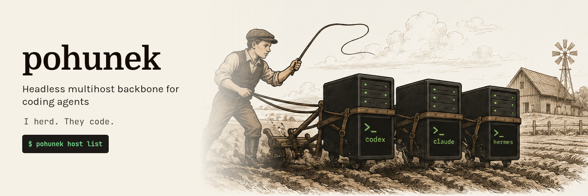

<p align="center">
  
</p>

<p align="center">
  <a href="https://github.com/zajca/pohunek/actions/workflows/ci.yml"></a>
  <a href="https://github.com/zajca/pohunek/releases/latest"></a>
  <a href="LICENSE"></a>
  
</p>

**pohunek** is a headless, multihost backbone for coding agents. One small Rust
daemon per machine. One durable terminal per Codex, Claude Code, or Hermes
Agent session. One versioned JSON contract for everything you build on top.

> A *pohunek* is the farmhand boy who drives the draft animals. He does not
> plow himself — he keeps the team moving.

The agents do the plowing. pohunek keeps them running on the right machine, in
the right worktree, and tells you or your tooling when one of them needs
attention.

> **Status: pre-1.0, experimental.** Wire shapes, config files, and on-disk
> metadata may change freely between releases. Linux-first; macOS on Apple
> Silicon is in progress.

## Two machines, one minute

```bash
# Which of your NetBird peers already run a daemon? No tokens, no server.
pohunek host discover

# Start Codex on the build box, in a fresh worktree, with its first prompt.
# Codex (like Claude Code) is served only by its official package: install it
# on buildbox first, then its hooks with `pohunek integration install --agent
# codex` (docs/install.md, "Install official runtime packages from the release
# archive").
# The project name resolves on buildbox; no filesystem path crosses the wire.
pohunek session new --host buildbox --project myapp --agent codex \
  --branch feat/parser --input "Fix the parser fuzz failures." --yes

# Find sessions linked to one work item; repeated metadata predicates are ANDed.
pohunek session list --meta-eq link.provider=github \
  --meta-eq link.id=owner/repo#123 --meta-has link.url

# Go do something else. When the agent waits for an approval or is blocked,
# the record lands here, from every host at once.
pohunek notifications watch --all-hosts

# Take over the terminal across the mesh; Ctrl-] leaves the agent running.
pohunek attach buildbox/s-01J00000000000000000000000

# What did it change? Diff of the remote worktree, untracked files included.
pohunek session diff buildbox/s-01J00000000000000000000000
```

Close the terminal, restart or upgrade the daemon: the session keeps the same
PTY and child PID. Logout, a host reboot, or a worker failure ends that runtime
generation; the session then shows `runtime.state=lost`, is never restarted
behind your back, and `pohunek session resume` recovers it on purpose when the
agent's native session id was captured.

## Why not a multiplexer and ssh

A multiplexer keeps a shell alive. It does not know that the process inside is
an agent, so every agent-aware need lands on whoever writes the tool. pohunek
handles it once, for every agent CLI:

| You need to | pohunek gives you |
|---|---|
| Know whether the agent is working, blocked on an approval, or idle | Live `working` / `blocked` / `idle` detection from OSC titles, screen patterns, and PTY activity. Detection rules are TOML manifests, so a new agent needs no recompile. |
| Submit a multi-line prompt into an Ink TUI without it being half-swallowed | `session input` with per-agent framing (bracketed paste, delayed submit). Prompts can come from stdin so they never appear in argv or logs. |
| Hear about it when something needs you, on any machine | Durable notification records (`unread → read → acknowledged → archived`), fed by agent hooks and daemon-side detection, deduped and debounced, fanned out with `--all-hosts`. |
| Keep two agents out of one working tree | `--branch` creates a worktree per session off the base branch; ownership is recorded and checked before any reuse or cleanup. |
| Get a conversation back, or branch it | Hooks capture the agent's own session id for explicit `session resume`; `session fork` branches a Claude Code conversation into a new session and PTY. |
| Watch without stealing the terminal | `session screen`, paged `session output` with exact runtime cursors, and `session wait` for bounded change polling. |
| Drive it from a script or another agent | One versioned `--json` envelope, typed errors with recovery hints, `subscribe` event streams, Rust and TypeScript SDKs. |

## What pohunek is built for

- **Headless by design.** This repository ships no user interface. The daemon,
  its protocol, the CLI with `--json`, and the SDKs are the product. Every GUI,
  launcher, or dashboard is a client of the same public contract: the Rust
  crate `pohunek-client` and the TypeScript packages `@pohunek/protocol`,
  `@pohunek/sdk` (with a node-free browser entry), and `@pohunek/testkit`
  speak one newline-delimited JSON protocol, with the TypeScript types
  generated from the Rust source of truth. A shell script around `--json` is a
  legitimate client too. [docs/sdk.md](docs/sdk.md) has the examples.
- **A stable base for tooling you build yourself.** Each agent CLI has its own
  TUI quirks, prompt framing, hooks, session ids, and resume and fork rules.
  pohunek absorbs those differences once, so your scripts, launchers, review
  bots, and manager agents talk to one contract instead of every harness.
- **Multihost from the start.** Every host is authoritative for its own
  sessions. The CLI and SDKs talk directly to each host's daemon: an owner-only
  Unix socket locally, a NetBird/WireGuard overlay remotely, bound only to the
  overlay address. No central server, no SaaS, no state sync. `--host buildbox`
  or a `buildbox/<session-id>` target is all it takes.
- **Driven by agents, not only by people.** Every automation command returns
  one versioned JSON envelope with typed errors. `pohunek agent-skill` prints
  the complete operating skill an agent needs, and `pohunek assistant` starts
  an agent session that already knows pohunek and your hosts.

```bash
# An agent, or your script, working a session on another host:
printf '%s' 'Run the focused tests.' \
  | pohunek session input buildbox/s-01J00000000000000000000000 --stdin --json
pohunek session wait buildbox/s-01J00000000000000000000000 \
  --activity idle --timeout-ms 8000 --json     # wakes on idle, or reports a timeout
pohunek agent-skill --json                     # the full skill text plus its sha256
pohunek assistant "why does attach fail on my laptop?"
```

```text
        your tooling: agents, scripts, launchers, GUIs, dashboards
                 |  pohunek CLI --json  ·  protocol  ·  SDKs
     +-----------+---------------+---------------------+
     | Unix socket               | NetBird/WireGuard   | NetBird/WireGuard
     v                           v                     v
  laptop: pohunekd         workstation: pohunekd    buildbox: pohunekd
     |                           |                     |
  durable PTY workers      durable PTY workers      durable PTY workers
  claude · codex           codex · hermes           claude · shell
```

Each daemon hands every session to its own `pohunek-sessiond` worker (a
systemd transient unit on Linux, a launchd job on macOS), which owns the PTY.
pohunek is built for one operator on machines they own: owner-only permissions
locally, your overlay's policies remotely, no multi-user auth, no hosted control
plane. [Features and architecture](docs/features.md) has the full list and the
trust boundary.

## Install with an agent

The easiest way to install pohunek is to let the coding agent you already use
do it. Open Claude Code, Codex, or another agent with shell access on the
machine that should become a pohunek host, and paste:

```text
Install pohunek (https://github.com/zajca/pohunek) on this machine and set it up
so you can drive it.

Read these first and follow them, they are the source of truth:
- https://raw.githubusercontent.com/zajca/pohunek/main/docs/install.md
- https://raw.githubusercontent.com/zajca/pohunek/main/docs/knowledge/guides/setup.md
- on macOS also https://raw.githubusercontent.com/zajca/pohunek/main/docs/knowledge/runbooks/install-on-macos.md

Rules:
1. Detect the OS and CPU. Linux x86_64 uses the latest release's
   pohunek-daemon-<version>-x86_64-unknown-linux-gnu.tar.gz (or -musl).
   macOS 14+ on Apple Silicon uses `brew install zajca/pohunek/pohunek`;
   tell me that macOS support is not declared final yet. For anything else,
   stop and tell me.
2. Verify every download with its .sha256 file and, when `gh` is available,
   `gh attestation verify <file> --repo zajca/pohunek`. Stop on any mismatch.
3. Before changing anything, run `pohunek service check --json` (from the
   extracted archive on Linux), show me what will be installed where, and wait
   for my approval. Then install the login service (`./packaging/install-daemon.sh`
   on Linux, `pohunek service install` on macOS). Never pass
   --accept-runtime-loss, --stop-sessions, or --purge. When an upgrade refuses
   with `service_upgrade_sessions_at_risk`, show me the listed sessions and
   reason codes instead of overriding it.
4. Verify with `pohunek doctor --json`, `pohunek service status --json`,
   `pohunek health --json`, and `pohunek host inspect local --json`. Report
   every warning; fix only what I approve.
5. Ask me before running `pohunek integration install --agent <runtime>`: it
   has no dry run and installs a SessionStart hook into that runtime's config
   home (for Claude Code `~/.claude`, for Codex `~/.codex`). Claude Code and
   Codex are served only by their official packages, so their hooks install
   only after the package does. Tell me which runtimes and configuration files
   it will touch and wait for my approval.
6. Run `pohunek agent-skill` and save its output as a skill or instruction file
   in your own harness, so later sessions know how to drive pohunek. Tell me
   where you saved it.
7. If this machine is in a NetBird network, run
   `pohunek host discover --refresh --json` and list the hosts that already run
   pohunek.
8. Never put secrets into commands, logs, or your summary. End with the
   installed version, paths, open warnings, and next steps.
```

Repeat it on every machine that should host sessions. Each host needs its own
daemon, and remote hosts must be members of the same NetBird network. Once the
daemon runs, `pohunek assistant setup` starts an agent session with the offline
knowledge bundle and a redacted snapshot of your hosts. Use it to finish
projects, agent profiles, and remote hosts.

## Install manually

- **Linux x86_64:** each [release](https://github.com/zajca/pohunek/releases)
  publishes glibc and MUSL CLI and daemon archives. Unpack the daemon archive
  and run `./packaging/install-daemon.sh`.
- **macOS (Apple Silicon, macOS 14+):** `brew install zajca/pohunek/pohunek`,
  then `pohunek service install`. The archives are published, but macOS support
  is declared only after its acceptance gate
  ([#105](https://github.com/zajca/pohunek/issues/105)) passes.
- **From source (Rust 1.96+):**
  `cargo build --release --locked --bin pohunek --bin pohunekd --bin pohunek-sessiond`.

```bash
pohunek doctor                              # environment check
pohunek service status && pohunek health    # daemon installed and answering
# Claude Code is served only by its official package: install it from the
# extracted Linux daemon archive, then its hooks (session ids + notifications).
# The macOS archive carries no runtime package yet (#929).
pohunek plugin install runtime/packages/claude.tar.zst --catalog runtime/runtime-catalog.json --yes
pohunek integration install --agent claude
pohunek session new --agent claude --name "fix-login-bug"
pohunek attach <session-id>                 # Ctrl-] detaches, the agent keeps running
```

[docs/install.md](docs/install.md) covers archive verification, what the login
service installs, upgrades, the first worktree-isolated session, and runtime
packages: the official Pi, Codex, Claude Code, and Hermes packages that each
Linux daemon archive carries under `runtime/packages/` with the signed
`runtime/runtime-catalog.json`, and third-party packages trusted by an explicit
digest.

## Experiments built on pohunek

[`zajca/pohunek-work`](https://github.com/zajca/pohunek-work) holds the author's
own tooling on top of the core, and is the test that the core works as a
backbone: every surface there uses only the CLI with `--json` and the public
protocol through the SDKs, pinned to one core release. They show one way to
build on pohunek, not the way.

- **Workflow plugin.** Joins Linear or GitHub Issues, pull request state, and
  pohunek sessions into one table with a derived `on_turn` column (me, an
  agent, or a reviewer); named actions such as `implement`, `babysit`, `fix-ci`,
  and `review` launch linked sessions in fresh worktrees. Merging stays manual.
- **Native GUI** (`pohunek-gui`, Iced) for Linux (Wayland) and macOS; opening a
  session launches your own terminal.
- **Web control center**: Bun backend, Svelte SPA with an in-browser terminal,
  usable from a phone over the mesh.
- **Launchers**: rofi and sway scripts plus Linear and GitHub issue pickers.

The core never learns about Linear, GitHub, or work items. It knows sessions,
worktrees, projects, events, notifications, and opaque metadata, and leaves
everything domain-specific to clients like these.

## Use, extend, contribute

- **Use Pohunek** to keep agent terminals durable across daemon restarts,
  operate sessions directly across your NetBird hosts, or drive the public
  `--json` interface from scripts. Start with the
  [manual installation](docs/install.md) and [CLI guide](docs/cli.md).
- **Extend Pohunek** with a Rust or TypeScript client, scripts over the CLI,
  or runtime packages. The [SDK guide](docs/sdk.md),
  [versioned public API](docs/public-api.md), and
  [runtime package guide](docs/knowledge/guides/runtime-packages.md) describe
  those shipped extension points. UI and workflow products are separate
  clients, not core components.
- **Contribute** through [public issues](https://github.com/zajca/pohunek/issues),
  including the [maintainer-managed ready queue](https://github.com/zajca/pohunek/issues?q=is%3Aissue%20is%3Aopen%20label%3Areadiness%3Aready).
  Read the [contribution workflow](.agents/skills/contribute/SKILL.md) before
  choosing work. `readiness:ready` marks eligibility, not a reservation or
  merge promise; contributors do not need private Project access.

## Roadmap

A sketch of the main tracks. The linked epics and the
[repository milestones](https://github.com/zajca/pohunek/milestones) are the
public source of truth for scope, order, and status.

| Track | Where it is heading | Status |
|---|---|---|
| **Runtime plugin packages** — [#139](https://github.com/zajca/pohunek/issues/139) | Codex, Claude Code, and Hermes become signed, content-addressed runtime packages installed per host, with their own CI and compatibility matrix. Only `shell` stays built in. | In progress (17/28): the registry, package format, signed catalog, CLI lifecycle, and the Pi, Codex, and Claude Code packages have landed, with the compiled-in Codex and Claude Code removed; the Hermes extraction is in progress. |
| **Workflow plugins** — [#148](https://github.com/zajca/pohunek/issues/148), [#325](https://github.com/zajca/pohunek/issues/325), [#326](https://github.com/zajca/pohunek/issues/326) | Bounded out-of-process plugins with declared actions and event reactions, invoked from the CLI. This is the packaging path for `pohunek-work`-style tooling. They are separate from runtime packages and run as the owner over the public CLI or SDK; v1 adds no core channel for plugin data and no launch-time policy hook ([#480](https://github.com/zajca/pohunek/issues/480)). | In progress (2/4): the metadata filter and display decision are done; CLI actions and periodic jobs are open. |
| **More agents** — [#50](https://github.com/zajca/pohunek/issues/50), [#227](https://github.com/zajca/pohunek/issues/227) | Pi and OpenCode 2.x as further first-class runtimes. | Pi ships as an official runtime package; its end-to-end acceptance and OpenCode are open. |
| **Delegated task runs** — [#182](https://github.com/zajca/pohunek/issues/182), [WS1–WS8](https://github.com/zajca/pohunek/issues/219) | Tasks and turns over ordinary sessions: causal turn settlement, a blocking `task.wait`, typed results with repository evidence and checks, and an optional MCP adapter. Agents can then delegate work to other agents reliably. | RFC accepted; implementation started with the WS1 protocol |
| **Durability and detection** — [#420–#426](https://github.com/zajca/pohunek/issues/426), [#59–#67](https://github.com/zajca/pohunek/issues/67) | Recovery from crashes and host-wide session loss in one action, and explainable, arbitrated `working` / `blocked` / `idle` detection. | In progress: `lost` classification and recovery binding landed; one-action recovery and detection work are open. |
| **macOS** — [#94](https://github.com/zajca/pohunek/issues/94) | Native Apple Silicon hosts with launchd-owned durable workers. | In progress: archives and a Homebrew tap ship; support is declared after [#105](https://github.com/zajca/pohunek/issues/105). |
| **Optional team relay** — [#56](https://github.com/zajca/pohunek/issues/56) | A public, multi-team control plane: hosts open the WireGuard link to the relay themselves, and the relay adds team ACLs, routing, and audit. The direct owner path stays first-class, and the relay is to move to its own repository ([#417](https://github.com/zajca/pohunek/issues/417)). | Foundation (authentication, credentials) implemented; transport and team surfaces pending |
| **Dark factory** — [#185](https://github.com/zajca/pohunek/issues/185), [FS0–FS8](https://github.com/zajca/pohunek/issues/233) | Unattended manager/auditor delegation over the team relay, built as a client of the relay. | Design |

The longer narrative and the shipped foundations are in
[docs/ROADMAP.md](docs/ROADMAP.md).

## Documentation

| Document | Content |
|---|---|
| [Features and architecture](docs/features.md) | Everything the core does, the daemon/worker split, and the trust boundary |
| [Manual installation](docs/install.md) | Release archives, login service, upgrades, building from source, and a first session |
| [CLI guide](docs/cli.md) | Every command, multihost targeting, automation and observation, notifications, the assistant, and Hermes |
| [SDKs and your own client](docs/sdk.md) | Rust and TypeScript SDKs, connection, and event subscription examples |
| [Development](docs/development.md) | Workspace layout, gates, fast test loops, and release |
| [Knowledge guides](docs/knowledge/index.md) | Setup, remote hosts, project setup, agent skill, Hermes operator, and runbooks |
| [Public API](docs/public-api.md) | The versioned wire protocol |
| [Architecture](docs/architecture.md) | The authoritative design |

Repository implementation rules start at [AGENTS.md](AGENTS.md).

## License

[MIT](LICENSE). The Pohunek Hermes operator plugin and generated skill, shipped
in the official Hermes runtime package (`runtime-packages/hermes`), and the core
hook reporter compiled into the CLI are repository-owned MIT assets. Their
Python modules use only the Python standard library plus the pinned Hermes host
API; Pohunek does not bundle Hermes code, marks, model/provider SDKs, or
third-party Python dependencies in that package or the CLI archive.
